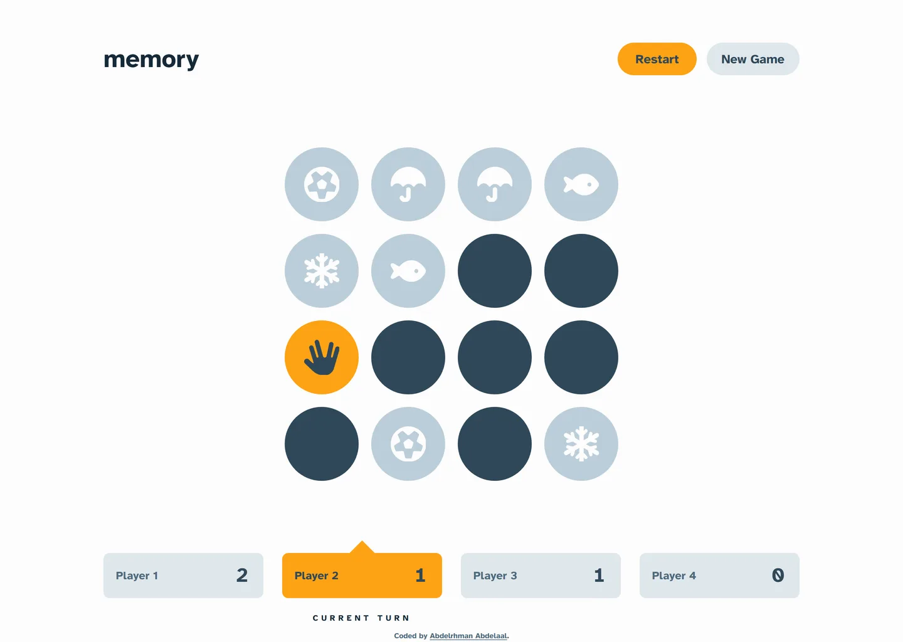

# memory

My solution to the [Memory game](https://www.frontendmentor.io/challenges/memory-game-vse4WFPvM) challenge on Frontend Mentor.

- Live: https://memory-game.abdelrhman-ahmed8881.workers.dev
- Code: https://github.com/MrBlackvanta/memory-game

## Built with

- Next.js
- React
- TypeScript
- Tailwind CSS
- [Font Awesome Free](https://fontawesome.com) icons, under [CC BY 4.0](https://fontawesome.com/license/free)

## Author

- [LinkedIn](https://www.linkedin.com/in/abdelrhman-vanta/)
- [UpWork](https://www.upwork.com/freelancers/mrblackvanta)
- [Frontend Mentor](https://www.frontendmentor.io/profile/MrBlackvanta)
